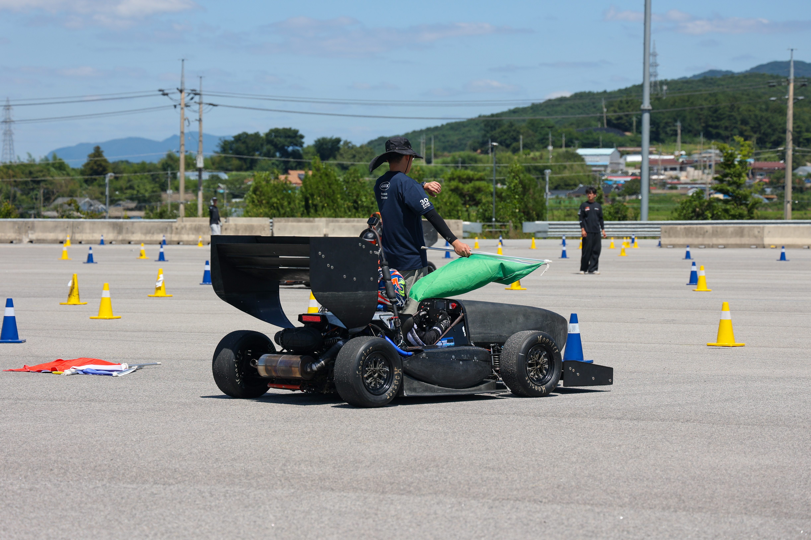
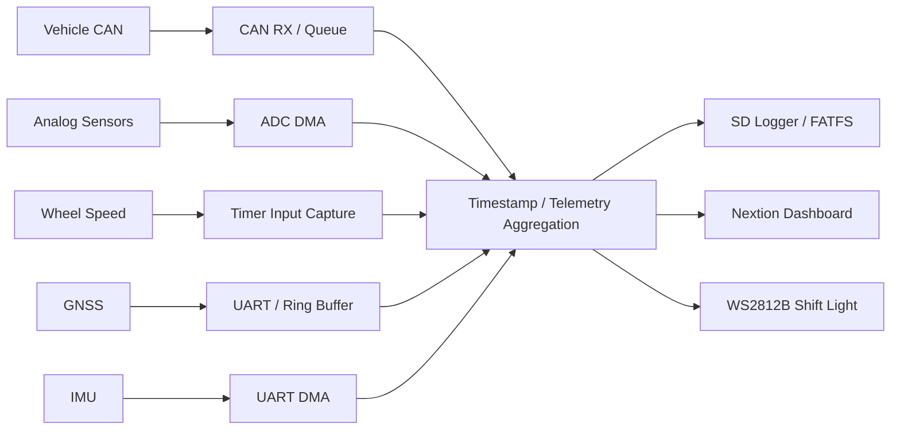
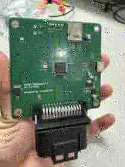
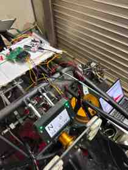
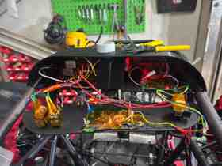
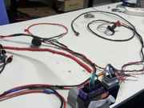

<p align="center"><sub>Formula Student Korea 2026 2nd Test Week · NS26F</sub></p>

# NS26F Electrical & Electronics

Formula Student 차량의 **전장 시스템과 임베디드 펌웨어를 직접 설계·통합하고 실제 주행 환경에서 검증한 프로젝트**입니다.

회로/PCB 설계뿐 아니라 STM32 기반 데이터 수집 펌웨어, CAN 통신, ADC/DMA, Timer Input Capture, UART 기반 GNSS·IMU, FATFS Logging, Dashboard/Shift Light까지 차량 내 데이터 흐름 전체를 구현했습니다.

> **Portfolio Focus:** Automotive Embedded Software / Vehicle Electronics / MCU Firmware / System Integration

## Project Overview

| 항목 | 내용 |
|---|---|
| Project | NS26F Formula Student Electrical & Electronics System |
| Role | 전장 파트장 |
| Main Scope | Embedded Firmware, Vehicle CAN, Data Logger, PCB, Harness, System Integration |
| MCU | STM32F405RGT6 |
| Interfaces | CAN, ADC, UART, Timer Input Capture, SDIO |
| Software | C, STM32 HAL, DMA/Interrupt, Ring Buffer/Queue, FATFS |
| Tools | STM32CubeIDE, STM32CubeMX, KiCad |
| Validation | 약 200 km 누적 테스트 주행 및 대회 환경 검증 |

## Problem & Goal

전년도 차량은 각 파트가 설계한 성능을 실제 주행 데이터로 정량적으로 확인하기 어려웠습니다.

이를 개선하기 위해 **CAN, Analog Sensor, Wheel Speed, GNSS/IMU처럼 서로 다른 인터페이스의 데이터를 하나의 MCU에서 수집하고 공통 시간축으로 저장하는 차량용 Data Logger**를 개발했습니다.

단순 Logging 장치가 아니라 실제 차량에서 통신·센서 입력·운전자 표시·데이터 저장이 동시에 수행되는 Embedded System을 목표로 했습니다.

## My Contribution

전장 파트장으로 차량 전장 시스템의 설계·제작·통합 및 검증을 총괄했습니다.

### Embedded Software

- STM32F405 기반 Data Logger Firmware 설계 및 구현
- CAN 500 kbps 수신 인터럽트, Frame Queue 및 차량 Signal 처리
- ADC DMA 기반 Analog Sensor Sampling
- Timer Input Capture 기반 Wheel Speed 측정
- UART 기반 GNSS NMEA Parsing 및 IMU DMA 수신/Packet Parsing
- 공통 Timestamp 기반 CAN / ADC / Wheel / IMU Data Aggregation
- microSD + FATFS 기반 CSV Logging
- Blocking SD I/O에 의한 Data Loss를 줄이기 위한 Queue/Ring Buffer 구조 적용
- SD Write Retry, Fault Logging 및 통신 오류 Recovery 로직 구현
- Nextion Dashboard 및 WS2812B Shift Light 출력
- Firmware 기능별 Module Refactoring 및 Legacy/Test Code 정리

### Hardware & System Integration

- STM32 기반 Data Logger 회로 및 PCB 설계
- 차량 CAN Network 및 Sensor Interface 구성
- 전장 Harness 경로 및 배선 구성
- PCB Bring-up / Debugging / 차량 탑재
- Bench Test 및 반복 실차 주행을 통한 시스템 검증

> 이 저장소에는 전장 파트 팀 산출물도 함께 포함되어 있습니다. 위 항목은 개인 포트폴리오 관점에서 직접 수행하거나 주도한 범위를 별도로 정리한 것입니다.

## Embedded Software Architecture



### Runtime Design

실차에서는 통신과 센서 입력이 동시에 발생하고 SD Card Write가 수 ms 이상 Blocking될 수 있습니다.

따라서 ISR에서는 가능한 짧게 데이터를 Queue/Ring Buffer에 적재하고, Parsing·Aggregation·File I/O는 foreground loop에서 처리하도록 구성했습니다.

이 구조를 통해 다음 문제를 다뤘습니다.

- CAN/UART 수신 중 SD Write에 의한 입력 손실
- 서로 다른 Sampling Rate의 Sensor Data 동기화
- UART DMA 및 Interrupt Error Recovery
- SD Card Write/Sync 실패 및 Fault 상태 기록
- HMI 출력과 Logging 작업 간 실행시간 간섭

## Requirements → Implementation

초기 요구사항에는 4-bit SDIO와 USB Mass Storage 기능도 포함되어 있었습니다.

실차 검증 과정에서는 **Logging 안정성을 우선하여 SDIO를 1-bit로 운용하고, FATFS가 SD Card를 사용하는 동안 Host와 동시에 접근할 수 있는 USB MSC 기능은 비활성화**했습니다.

즉 초기 명세를 그대로 유지하기보다 실제 차량 환경에서 발생하는 안정성 문제를 기준으로 설계를 조정했습니다.

초기 요구사항과 실제 구현 중 변경된 설계 판단은 [Software Requirements & Design Decisions](dashboard/datalogger/firmware/REQUIREMENTS.md)에 정리했습니다.

## Firmware Structure

현재 공개 Firmware는 약 4,700줄 규모의 단일 `main.c` 구조에서 기능별 Module로 정리했습니다.

```text
Core/
├── Inc/
│   └── app_internal.h
└── Src/
    ├── main.c
    ├── app.c
    ├── app_state.c
    ├── can_bus.c
    ├── adc_input.c
    ├── wheel_speed.c
    ├── gnss.c
    ├── imu.c
    ├── telemetry.c
    ├── sd_logger.c
    ├── dashboard.c
    ├── shiftlight.c
    ├── app_callbacks.c
    └── led_diag.c
```

각 기능의 책임과 상세 구현은 [Datalogger Firmware](dashboard/datalogger/firmware/README.md)에서 확인할 수 있습니다.

> 실제 차량에서 사용된 통합 Firmware의 동작 경험을 바탕으로 공개 코드 구조를 Module 단위로 정리했습니다. 현재 Refactor Code는 정적 구조 검사를 완료했으며, Hardware Regression은 별도 환경에서 재확인이 필요합니다.

## Hardware & Vehicle Validation

<table>
<tr>
<td width="50%" align="center">
<br>
<sub>STM32 기반 Data Logger PCB — 직접 설계·제작한 V1 보드</sub>
</td>
<td width="50%" align="center">
<br>
<sub>차량 탑재 전/개발 중 전장 Integration Test</sub>
</td>
</tr>
<tr>
<td width="50%" align="center">
<br>
<sub>Dashboard 내부 실제 차량 장착 및 전장 통합</sub>
</td>
<td width="50%" align="center">
<br>
<sub>차량 Harness 제작 및 배선 통합</sub>
</td>
</tr>
</table>

> Integration Test 사진은 개발/검증 단계의 임시 배선을 포함합니다. 최종 양산 배선 품질을 나타내기 위한 사진이 아니라 실제 차량에서 Interface와 기능을 확인한 개발 과정 기록입니다.

## Verification

1. Interface 단위 기능 확인
2. CAN / ADC / Timer / UART 개별 입력 검증
3. SD Logging 및 파일 무결성 확인
4. Dashboard / Shift Light 출력 통합
5. 차량 탑재 후 Sensor / ECU / Harness 통합
6. 반복 주행 중 Data Loss 및 통신 오류 확인
7. 문제 수정 후 재검증

완성된 전장 시스템과 Data Logger는 약 200 km의 누적 테스트 주행과 Formula Student 대회 환경에서 사용했습니다.

> 본 프로젝트의 검증 범위는 Formula Student 차량의 개발 및 대회 환경입니다. 양산 자동차 규격(AEC-Q, ISO 16750 등)에 따른 Automotive Qualification을 의미하지 않습니다.

## Other Electrical Modules

| Module | Description | Path |
|---|---|---|
| Brake Light | LED Brake Light PCB, KiCad 및 생산 파일 | [`brake-light/`](brake-light/) |
| Data Logger | STM32 기반 다채널 차량 Data Acquisition System | [`dashboard/datalogger/`](dashboard/datalogger/) |
| Dashboard UI | Nextion 기반 운전자 표시 UI | [`dashboard/display-ui/`](dashboard/display-ui/) |
| Shift Light | WS2812B 기반 RPM Shift Light | [`dashboard/shiftlight/`](dashboard/shiftlight/) |
| Telemetry | LoRa 기반 차량 데이터 무선 전송 및 Viewer | [`telemetry/`](telemetry/) |
| Harness | 차량 전장 Harness 자료 | [`harness/`](harness/) |

## Repository Structure

```text
NS26F-Electrical-Electronics-Part/
├── brake-light/
├── dashboard/
│   ├── display-ui/
│   ├── datalogger/
│   │   ├── hardware/
│   │   └── firmware/
│   └── shiftlight/
├── telemetry/
├── harness/
├── docs/
├── shared/
├── releases/
└── archive/
```

## Documents

- [Data Logger](dashboard/datalogger/README.md)
- [Data Logger Hardware](dashboard/datalogger/hardware/README.md)
- [Data Logger Firmware](dashboard/datalogger/firmware/README.md)
- [Brake Light](brake-light/README.md)
- [Shift Light](dashboard/shiftlight/README.md)
- [Telemetry](telemetry/README.md)
