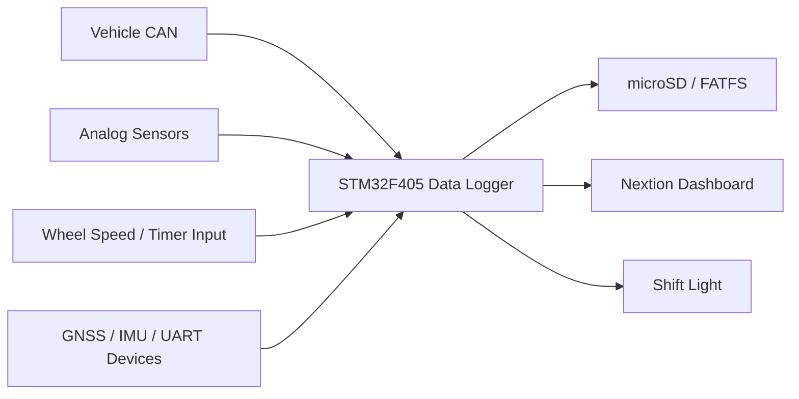

<p align="center"><sub>Formula Student Korea 2026 2nd Test Week · NS26F</sub></p>

# NS26F Electrical & Electronics

Formula Student 차량의 전장 시스템을 설계·제작하고 실제 주행 환경에서 검증한 프로젝트입니다.

이 저장소는 NS26F 전장 파트의 공개 가능한 산출물을 정리한 통합 저장소이며, 회로/PCB, STM32 펌웨어, 계기판 UI, 무선 텔레메트리 및 생산 파일을 포함합니다.

## Project Overview

| 항목 | 내용 |
|---|---|
| Project | NS26F Formula Student Electrical & Electronics System |
| Role | 전장 파트장 |
| Main Scope | 차량 전장 시스템 통합, STM32 Data Logger, CAN, Harness, PCB, 실차 검증 |
| MCU | STM32F405RGT6 |
| Interfaces | CAN, ADC, UART, Timer Input Capture, SDIO |
| Tools | KiCad, STM32CubeIDE, STM32CubeMX |
| Validation | 약 200 km 누적 테스트 주행 및 대회 환경 검증 |

### 목표

전년도 차량은 각 파트가 설계한 성능을 실제 주행 데이터로 정량적으로 확인하기 어려웠습니다.

이를 개선하기 위해 차량에 분산된 센서 및 제어기 데이터를 하나의 시스템에서 수집·저장하고, 실제 주행 결과를 차량 세팅과 설계 검증에 활용할 수 있는 전장 환경을 구축했습니다.

## My Contribution

전장 파트장으로 차량 전장 시스템의 설계·제작·통합 및 검증을 총괄했습니다.

주요 직접 수행 범위는 다음과 같습니다.

- STM32 기반 차량용 Data Logger 회로 및 PCB 설계
- CAN, ADC, UART, Timer Input Capture 기반 센서/제어기 인터페이스 구성
- 차량 CAN 통신 및 데이터 수집 구조 구성
- 전장 Harness 경로 및 배선 구성
- PCB 제작 후 Bring-up, Debugging 및 차량 탑재
- Bench Test 및 반복 실차 주행을 통한 동작 검증
- 주행 데이터 기반 차량 상태 확인 및 세팅 지원

> 이 저장소에는 전장 파트 팀 산출물도 함께 포함되어 있습니다. 위 항목은 개인 포트폴리오 관점에서 직접 수행하거나 주도한 범위를 별도로 정리한 것입니다.

## System Overview

### Data Logger



Data Logger는 여러 형태의 차량 데이터를 공통 시간축에서 수집하여 microSD에 기록하도록 구성했습니다.

현재 공개 펌웨어에는 다음 기능이 포함되어 있습니다.

- CAN 500 kbps 수신 및 주요 차량 신호 처리
- ADC 센서 입력
- Wheel Speed Input Capture
- GNSS / IMU UART 입력
- microSD FATFS 기반 CSV Logging
- Nextion HMI 출력
- WS2812B Shift Light 제어
- Logging Fault 진단 및 SD I/O 오류 처리

상세 내용은 [Datalogger 문서](dashboard/datalogger/README.md)를 참고하십시오.

## Hardware & Vehicle Validation

<table>
<tr>
<td width="50%" align="center">
<br>
<sub>STM32 기반 Data Logger PCB — 직접 설계·제작한 V1 보드</sub>
</td>
<td width="50%" align="center">
<br>
<sub>차량 탑재 전/개발 중 전장 Integration Test</sub>
</td>
</tr>
<tr>
<td width="50%" align="center">
<br>
<sub>Dashboard 내부 실제 차량 장착 및 전장 통합</sub>
</td>
<td width="50%" align="center">
<br>
<sub>차량 Harness 제작 및 배선 통합</sub>
</td>
</tr>
</table>

> Integration Test 사진은 개발/검증 단계의 임시 배선을 포함합니다. 최종 양산 배선 품질을 나타내기 위한 사진이 아니라 실제 차량에서 인터페이스와 기능을 확인한 개발 과정 기록입니다.

### Other Electrical Modules

| Module | Description | Path |
|---|---|---|
| Brake Light | LED Brake Light PCB, KiCad 및 생산 파일 | [`brake-light/`](brake-light/) |
| Data Logger | STM32 기반 다채널 차량 데이터 수집 및 저장 | [`dashboard/datalogger/`](dashboard/datalogger/) |
| Dashboard UI | Nextion 기반 운전자 표시 UI | [`dashboard/display-ui/`](dashboard/display-ui/) |
| Shift Light | WS2812B 기반 RPM Shift Light PCB | [`dashboard/shiftlight/`](dashboard/shiftlight/) |
| Telemetry | LoRa 기반 차량 데이터 무선 전송 및 Viewer | [`telemetry/`](telemetry/) |
| Harness | 차량 전장 Harness 자료 | [`harness/`](harness/) |

## Design & Verification Approach

이 프로젝트에서는 단순히 회로와 PCB를 제작하는 것보다 **실제 차량 환경에서 안정적으로 동작하는지 확인하는 것**을 중요하게 두었습니다.

1. 필요한 차량 신호와 인터페이스 정의
2. 회로 및 PCB 설계
3. 개별 Interface Bench Test
4. 차량 전장 시스템 통합
5. 반복 테스트 주행
6. 데이터/통신/배선 이상 원인 추적
7. 수정 후 재검증

완성된 전장 시스템과 Data Logger는 약 200 km의 누적 테스트 주행과 Formula Student 대회 환경에서 사용하며 검증했습니다.

> 본 프로젝트의 검증 범위는 Formula Student 차량의 개발 및 대회 환경입니다. 양산 자동차 규격(AEC-Q, ISO 16750 등)에 따른 Automotive Qualification을 의미하지 않습니다.

## Repository Structure

```text
NS26F-Electrical-Electronics-Part/
├── brake-light/                         # Brake Light HW
├── dashboard/
│   ├── display-ui/                      # Nextion HMI
│   ├── datalogger/
│   │   ├── hardware/                    # KiCad / schematic / PCB / production
│   │   └── firmware/                    # STM32CubeIDE firmware
│   └── shiftlight/                      # Shift Light HW
├── telemetry/                           # LoRa telemetry & viewers
├── harness/                             # Harness documents
├── docs/                                # Common documents / images
├── shared/                              # Shared libraries / DBC
├── releases/                            # Release files
└── archive/                             # Local backup, excluded from Git
```

## Public Repository Notes

- 설계 원본과 함께 브라우저에서 바로 확인할 수 있는 문서를 우선 제공합니다.
- KiCad 원본, BOM, 생산 파일은 각 Hardware 디렉터리에 있습니다.
- STM32CubeIDE 프로젝트와 CubeMX 설정 파일은 Data Logger Firmware 디렉터리에 있습니다.
- 실제 차량/팀 운영에 민감한 정보와 개인정보는 공개 저장소에서 제외합니다.

## Documents

- [Data Logger](dashboard/datalogger/README.md)
- [Data Logger Hardware](dashboard/datalogger/hardware/README.md)
- [Data Logger Firmware](dashboard/datalogger/firmware/README.md)
- [Brake Light](brake-light/README.md)
- [Shift Light](dashboard/shiftlight/README.md)
- [Telemetry](telemetry/README.md)
