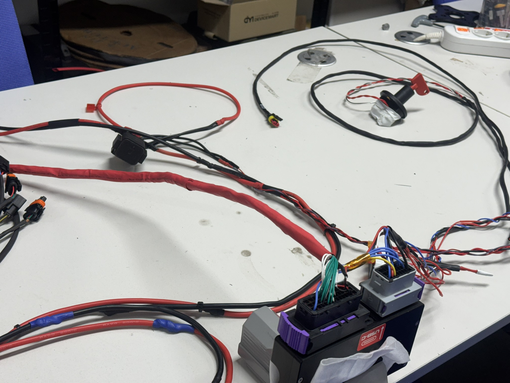

# Harness

NS26F Formula Student 차량 전장 Harness 관련 공개 문서입니다.

차량 Harness는 전장 파트에서 직접 설계·제작했으며, ECU·센서·전원·통신 배선을 차량 레이아웃에 맞춰 통합했습니다.

 
차량 Harness 제작 및 Connector/전원·신호 배선 통합 과정

## Scope

- 차량 내 ECU·센서·전장 장치 연결
- 전원 및 Signal Harness 구성
- CAN 통신 배선 통합
- Connector 및 Branch 구성
- 차량 레이아웃을 고려한 Harness Routing
- 제작 후 Continuity / 기능 확인 및 차량 장착

현재 공개 저장소에는 세부 Harness 원본 도면과 전체 Pin Map은 포함하지 않았습니다. 공개 포트폴리오에서는 시스템 구성과 실제 제작·통합 경험을 확인할 수 있는 범위의 자료만 제공합니다.

> 차량 세부 배선도, 개인/팀 내부 운영정보, 외부 제공 자료 등 공개에 부적절한 정보는 제외합니다.
